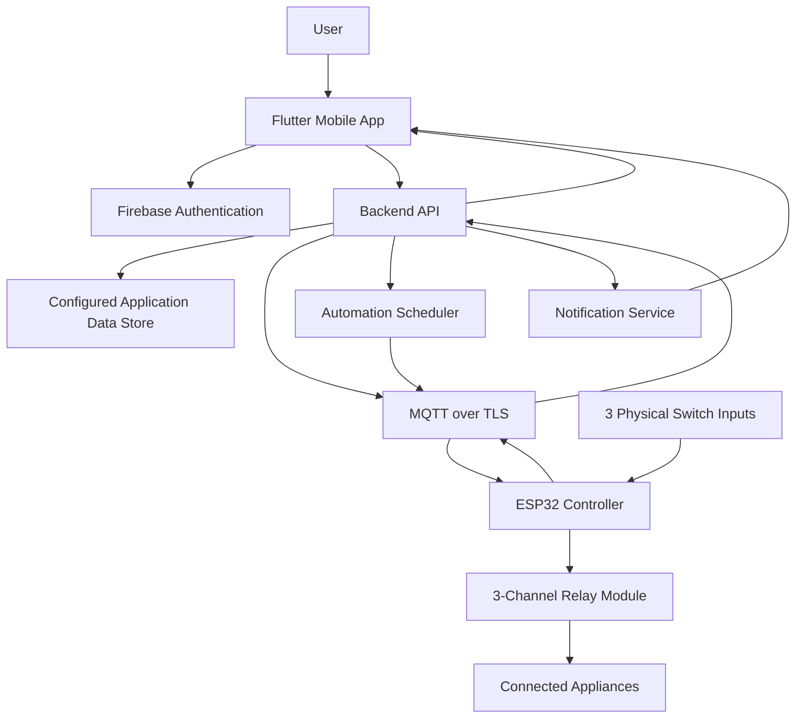

# 🏡 Haven — Smart Home Automation

<p align="center">
  <strong>A secure, connected, and intelligent smart home control system powered by ESP32, Flutter, Firebase, and MQTT.</strong>
</p>

<p align="center">
  
  
  
  
  
  
</p>

Haven is a smart home automation project designed to let users monitor and control connected household appliances through a mobile application. It combines an ESP32-based controller, Wi-Fi connectivity, MQTT messaging, Firebase services, and a Flutter mobile interface.

The goal is to make home automation convenient, accessible, extensible, and suitable for a real hardware deployment.

> **Project status:** Under development. Production readiness depends on completing hardware integration, security configuration, testing, deployment, and validation on the actual device.

---

## 📑 Table of Contents

- [Overview](#-overview)
- [Key Features](#-key-features)
- [System Architecture](#-system-architecture)
- [Technology Stack](#-technology-stack)
- [Project Structure](#-project-structure)
- [How It Works](#-how-it-works)
- [Hardware Requirements](#-hardware-requirements)
- [Software Requirements](#-software-requirements)
- [Getting Started](#-getting-started)
- [Mobile Application Setup](#-mobile-application-setup)
- [Backend Setup](#-backend-setup)
- [Firebase Setup](#-firebase-setup)
- [MQTT Configuration](#-mqtt-configuration)
- [ESP32 Firmware Setup](#-esp32-firmware-setup)
- [Automation and Scheduling](#-automation-and-scheduling)
- [Voice Control](#-voice-control)
- [Security](#-security)
- [Testing](#-testing)
- [Deployment](#-deployment)
- [Troubleshooting](#-troubleshooting)
- [Production Readiness Checklist](#-production-readiness-checklist)
- [Future Enhancements](#-future-enhancements)
- [Contributing](#-contributing)
- [License](#-license)
- [Disclaimer](#-disclaimer)

---

## 🌟 Overview

Haven aims to provide a unified mobile interface for controlling electrical appliances connected to an ESP32-based relay controller.

The system is designed around three relay channels and three physical switch inputs. Users can control supported appliances through the mobile application while retaining the ability to operate them using physical switches.

The architecture is intended to support:

- Room-based appliance organization.
- Remote ON/OFF commands over Wi-Fi.
- Real-time device status updates.
- Time-based automation.
- Voice-assisted commands.
- Notifications and device connectivity indicators.
- A backend and cloud services that can be extended as the project grows.

Haven is designed to work with compatible ESP32 controllers running the project's standardized firmware and topic conventions. Compatibility with additional boards requires validation of their GPIO configuration, relay behavior, firmware, and network setup.

## ✨ Key Features

### 📱 Mobile Application

- Flutter-based application for Android and iOS.
- Appliance controls with ON/OFF states.
- Room-wise organization of connected devices.
- Device connection and availability indicators.
- Responsive user interface.
- User-specific configuration where authentication is implemented.

### 🔌 ESP32 Hardware Control

- ESP32 Wi-Fi connectivity.
- Support for three relay-controlled appliance channels in the planned hardware configuration.
- Three physical switch inputs.
- Mobile and physical-switch control.
- Firmware-based command processing.
- Device status reporting through the configured messaging protocol.

### ⏰ Scheduling and Automation

- Schedule an appliance to turn ON or OFF at a specified time.
- Configure recurring schedules where supported.
- Enable or disable individual schedules.
- Display scheduled actions in the mobile application.
- Synchronize device state with automation status.

Actual scheduling behavior depends on the implemented scheduler, time synchronization, network availability, and firmware capabilities.

### 🎙️ Voice Control

- Voice-assisted appliance commands.
- Commands intended to control supported appliances by room or device name.
- Confirmation of recognized commands before execution where appropriate.
- Clear feedback when a command cannot be understood or completed.

Voice input must be connected to a functioning speech-recognition implementation. It should not be treated as proof that a physical relay changed state.

### ☁️ Cloud Integration

- Firebase integration for supported authentication, application data, or notifications.
- MQTT messaging for communication with connected hardware.
- Backend services for validated operations and integrations.
- Cloud deployment support for the backend.
- A foundation for adding more devices and automation rules.

Feature availability depends on the corresponding services being configured and implemented. This README does not imply that every listed capability has already been tested on physical hardware.

---

## 🏗️ System Architecture



### Architecture Components

| Component | Responsibility |
|---|---|
| Flutter mobile app | User interface, appliance controls, schedules, and device information |
| Firebase | Authentication and other configured Firebase services |
| Backend API | Request validation, authorization, automation logic, and integrations |
| Application data store | Persistent user, device, and schedule data, depending on the implemented configuration |
| MQTT broker | Messaging between authorized application services and ESP32 devices |
| ESP32 firmware | Processes commands, controls relays, reads physical switches, and reports status |
| Relay module | Electrically switches supported appliance circuits |
| Physical switches | Provide local appliance control |

The diagram describes the intended architecture. Adapt it to the actual implementation if the app, backend, database, scheduler, or MQTT connection follows a different flow.

---

## 🧰 Technology Stack

| Technology | Purpose |
|---|---|
| Flutter | Cross-platform mobile application |
| Dart | Mobile application programming language |
| ESP32 | Wi-Fi-enabled hardware controller |
| Embedded C/C++ | ESP32 firmware |
| MQTT | Lightweight device messaging |
| HiveMQ Cloud | Managed MQTT broker, if selected and configured |
| TLS | Encryption for supported network connections |
| Firebase Authentication | User authentication, if enabled |
| Cloud Firestore or another configured store | Application data persistence, depending on implementation |
| Node.js | Backend runtime |
| Express.js | Backend HTTP API |
| Google Cloud Run | Backend deployment target, if configured |
| Git and GitHub | Version control and collaboration |

Use the actual dependency versions and services defined in the project's configuration files. Do not assume that a technology listed here has been fully integrated until verified in the codebase.

---

## 📂 Project Structure

```text
haven/
├── backend/
│   ├── src/
│   ├── package.json
│   ├── .env.example
│   └── README.md
│
├── docs/
│   ├── architecture.md
│   ├── hardware-setup.md
│   ├── mqtt-topics.md
│   └── testing.md
│
├── firebase/
│   ├── firestore.rules
│   ├── firestore.indexes.json
│   └── README.md
│
├── firmware/
│   ├── src/
│   ├── include/
│   ├── platformio.ini
│   └── README.md
│
├── infrastructure/
│   ├── deployment/
│   └── README.md
│
├── mobile/
│   ├── lib/
│   ├── test/
│   ├── pubspec.yaml
│   └── README.md
│
├── .gitignore
├── LICENSE
└── README.md
```

This is the intended high-level structure. Actual filenames and subdirectories may differ depending on the current implementation.

---

## 🔄 How It Works

### 1. Initial Setup

1. The user installs and opens the mobile application.
2. The user completes authentication if required by the configured app.
3. The user configures the supported device and its connection details.
4. The ESP32 connects to the configured Wi-Fi network.
5. The ESP32 establishes a connection with the configured MQTT broker.

### 2. Appliance Control

1. The user selects an appliance in the mobile application.
2. The application sends an authorized command through the configured backend or messaging flow.
3. The backend validates the request and publishes the appropriate MQTT message.
4. The ESP32 receives the command and updates the corresponding relay.
5. The ESP32 publishes a status update.
6. The application displays the reported device state.

The application should distinguish between a requested state and a state confirmed by the device.

### 3. Physical Switch Control

1. The user operates a physical switch.
2. The ESP32 detects the switch input.
3. The firmware applies the configured relay behavior.
4. The ESP32 publishes the resulting state.
5. The application updates its displayed state when the status message is received.

### 4. Connectivity and Recovery

The system should detect disconnections, avoid treating stale status as current, and reconnect safely. Commands should be validated and handled according to a documented retry and acknowledgement strategy.

---

## 🔧 Hardware Requirements

The planned hardware configuration includes:

- ESP32 development board with Wi-Fi.
- Three-channel relay module compatible with the chosen controller and electrical design.
- Three physical switches or suitable input circuits.
- Appropriate power supply.
- Suitable wiring and connectors.
- USB cable for programming and debugging.
- A Wi-Fi network with internet access if cloud services are required.
- Supported appliances for controlled testing.

Additional components may be required based on the board, relay module, enclosure, isolation, and electrical installation.

### Hardware Considerations

- Confirm the relay module's input voltage and current requirements.
- Select ESP32 GPIO pins that are appropriate for the board and do not interfere with boot behavior.
- Use appropriate pull-up or pull-down circuits for switch inputs.
- Define a safe relay state during startup, reset, and firmware failure.
- Use suitable electrical isolation, enclosures, fusing, and strain relief.
- Validate the design before connecting mains-powered appliances.

Refer to the hardware documentation for the exact pin assignments and wiring diagram.

---

## 💻 Software Requirements

Install the tools required by the parts of the project you intend to run:

- Git.
- Flutter SDK and Dart SDK.
- Android Studio or another supported Android development setup.
- Xcode on macOS for native iOS development and signing.
- Node.js and npm for the backend.
- PlatformIO or the firmware toolchain used by the project.
- A Firebase project with the required services enabled.
- An MQTT broker account, if using a managed broker.
- Google Cloud CLI if deploying to Google Cloud Run.

Verify that the required tools are available:

```bash
git --version
flutter --version
dart --version
node --version
npm --version
```

For firmware, follow the commands and environment specified by the actual firmware project.

---

## 🚀 Getting Started

### 1. Clone the Repository

```bash
git clone https://github.com/YOUR_USERNAME/haven.git
cd haven
```

Replace `YOUR_USERNAME` with the GitHub account or organization that hosts the repository.

### 2. Configure Environment Variables

Create local environment files based on the example files provided by each component.

For example:

```bash
cp backend/.env.example backend/.env
```

On Windows PowerShell, use:

```powershell
Copy-Item backend/.env.example backend/.env
```

If an example file does not exist yet, create one based on the configuration required by the application. Do not commit actual credentials.

### 3. Configure Cloud Services

Set up the required Firebase project, MQTT broker, backend environment, and mobile configuration. Follow the relevant sections below.

### 4. Run Each Component

Start the backend, run the mobile application, and flash the ESP32 firmware using the instructions for the actual code and toolchain.

The system is fully operational only after its components are configured and successfully tested together.

---

## 📱 Mobile Application Setup

Navigate to the mobile directory:

```bash
cd mobile
```

Install Flutter dependencies:

```bash
flutter pub get
```

Check the project for configuration and dependency issues:

```bash
flutter analyze
flutter test
```

Run the application on a connected device or emulator:

```bash
flutter devices
flutter run
```

### Mobile Configuration

Configure the application using the project's supported configuration mechanism for:

- Backend API base URL.
- Firebase project configuration.
- Authentication settings.
- Device registration and identification.
- MQTT-related configuration, only if the mobile app is designed to connect directly to the broker.

Do not hardcode production credentials, private broker passwords, service-account keys, or privileged API secrets in Dart source code or in a mobile application's bundled configuration.

For iOS, complete the required Apple signing and platform configuration. For Android, configure the appropriate application ID, permissions, signing, and release build settings.

---

## 🖥️ Backend Setup

Navigate to the backend directory:

```bash
cd backend
```

Install dependencies:

```bash
npm install
```

Create and configure the local environment file. The exact variable names must match the backend implementation.

Example configuration template:

```dotenv
NODE_ENV=development
PORT=3000

# Configure these according to the actual implementation.
FIREBASE_PROJECT_ID=
MQTT_BROKER_URL=
MQTT_USERNAME=
MQTT_PASSWORD=
```

Do not use this template as a substitute for the project's actual environment-variable definitions. Add any required database, authentication, certificate, or service configuration used by the backend.

Start the backend using the script defined in `package.json`. For example, if a development script exists:

```bash
npm run dev
```

Otherwise, use the project's documented start command.

### Backend Responsibilities

The backend should:

- Authenticate users where required.
- Authorize users to access specific devices.
- Validate appliance commands and schedule requests.
- Publish commands to the correct MQTT topics.
- Process device status messages.
- Apply input validation, rate limits, and error handling.
- Avoid exposing private MQTT credentials to unauthorized clients.
- Log useful diagnostic information without recording passwords or tokens.

---

## 🔥 Firebase Setup

1. Create or select a Firebase project.
2. Register the supported Android and iOS applications.
3. Configure Firebase using the official platform-specific setup process.
4. Enable Firebase Authentication if the application uses it.
5. Configure the selected database or notification services only if the application requires them.
6. Apply security rules that restrict access to authorized users.
7. Test authentication, access control, and data persistence.

### Firebase Security

- Do not commit service-account private keys.
- Do not deploy permissive database rules to production.
- Do not assume that Firebase client configuration alone provides authorization.
- Validate privileged operations in trusted backend services.
- Restrict access to user-owned devices and schedules.
- Test that one user cannot read or control another user's devices.

The exact Firebase services depend on the application's implementation.

---

## 📡 MQTT Configuration

Haven uses MQTT as the intended messaging protocol for communication between the backend and ESP32 controller.

If using HiveMQ Cloud, create a broker deployment and configure the required connection details. Use the secure TLS endpoint and credentials supplied by the broker.

### Example Topic Convention

The following topic names are illustrative. They must match the topics implemented in the backend and ESP32 firmware.

| Purpose | Example topic | Direction |
|---|---|---|
| Appliance command | `haven/devices/{deviceId}/commands` | Backend → ESP32 |
| Device state | `haven/devices/{deviceId}/state` | ESP32 → Backend |
| Device availability | `haven/devices/{deviceId}/availability` | ESP32 → Backend |
| Device telemetry | `haven/devices/{deviceId}/telemetry` | ESP32 → Backend |

Replace `{deviceId}` with the actual device identifier. Use a consistent topic scheme throughout the application.

### Example Command Payload

```json
{
  "commandId": "unique-command-id",
  "deviceId": "device-001",
  "channel": 1,
  "state": "ON"
}
```

### Example State Payload

```json
{
  "deviceId": "device-001",
  "channel": 1,
  "state": "ON",
  "reportedAt": "2026-10-23T12:00:00Z"
}
```

These payloads are examples of a possible message contract, not a claim about the current firmware's exact format.

### MQTT Best Practices

- Use TLS for network connections.
- Use unique credentials where supported.
- Apply topic-level access controls.
- Separate command permissions from read-only status permissions.
- Validate device IDs, channels, payload types, and allowed state values.
- Reject malformed and unauthorized commands.
- Use command IDs or equivalent mechanisms to handle duplicate messages safely.
- Design reconnection and acknowledgement behavior deliberately.
- Avoid logging sensitive credentials.
- Document QoS, retained-message behavior, and Last Will configuration.

Do not allow untrusted clients to publish commands to every device.

---

## ⚙️ ESP32 Firmware Setup

Navigate to the firmware directory:

```bash
cd firmware
```

Open the firmware project in the configured development environment.

If the project uses PlatformIO, install the required platform and libraries, verify the environment in `platformio.ini`, and build the firmware using the commands supported by that configuration.

Common PlatformIO CLI commands, when applicable, are:

```bash
pio run
pio device list
pio run --target upload
pio device monitor
```

The commands require PlatformIO CLI and a correctly configured board environment.

### Firmware Configuration

Configure the ESP32 with the values required by the implementation:

- Wi-Fi network credentials.
- MQTT broker hostname and secure port.
- MQTT authentication credentials.
- Device identifier.
- Relay GPIO pin assignments.
- Physical switch GPIO pin assignments.
- TLS certificate validation settings.
- Reconnection and command timeout behavior.

Use a secure provisioning mechanism or a local, untracked configuration file. Never publish your home Wi-Fi password or broker credentials in a public repository.

### Firmware Behavior

The firmware should:

- Initialize relay outputs into a safe, documented state.
- Connect to Wi-Fi and the MQTT broker.
- Subscribe only to the topics required by the device.
- Validate received commands before acting.
- Control the appropriate relay channel.
- Read physical switch inputs with suitable debounce handling.
- Publish confirmed state updates.
- Handle disconnections and reconnect safely.
- Reject unsupported channels and malformed messages.
- Avoid unsafe relay changes during reset or connection recovery.

Confirm the actual pin map, relay polarity, switch behavior, and power-on state using the hardware documentation.

---

## ⏰ Automation and Scheduling

Scheduling allows users to define when a supported appliance should change state.

A schedule may contain:

- Schedule identifier.
- Device identifier.
- Relay channel.
- Requested state.
- Execution time.
- Time zone.
- Recurrence configuration.
- Enabled or disabled status.

### Recommended Scheduling Behavior

1. Validate the requested schedule.
2. Store it in the configured persistent data store.
3. Evaluate the schedule using a trusted time source.
4. Confirm that the schedule is still enabled and authorized.
5. Issue the appropriate device command.
6. Record the result and report failures where possible.

### Reliability Considerations

- Handle time zones and daylight-saving changes where applicable.
- Use synchronized time on devices that depend on local clocks.
- Define what happens when the device or network is offline.
- Prevent duplicate execution after retries or service restarts.
- Provide a way to disable or delete schedules.
- Display execution status rather than assuming every command succeeded.

Scheduling is only production-ready when its persistence, execution, retry, and recovery behavior have been implemented and tested.

---

## 🎙️ Voice Control

Voice control is intended to let users request actions such as turning a supported light on or off.

Example user commands:

- “Turn on the living room light.”
- “Turn off the bedroom light.”
- “Switch off the kitchen appliance.”

The voice interface should map recognized speech to a known device and a valid action. It should not execute arbitrary text as a hardware command.

### Voice Control Requirements

- Request microphone permission when needed.
- Explain the purpose of microphone access.
- Validate the recognized command.
- Resolve the intended device unambiguously.
- Show clear feedback when recognition fails.
- Handle permission denial and unsupported devices.
- Confirm the resulting state using device feedback.

Voice control must use an actual speech-recognition implementation supported by the application. If recognition is unavailable, the app should communicate that clearly and keep manual controls usable.

---

## 🔐 Security

Security is essential because the application can control physical devices.

### Application Security

- Protect authenticated routes.
- Enforce device ownership and authorization on the backend.
- Validate all inputs.
- Avoid exposing privileged credentials in the mobile app.
- Use secure storage for supported local secrets.
- Use HTTPS for production API communication.
- Apply appropriate rate limits and error handling.

### MQTT and Device Security

- Use TLS with certificate validation.
- Use unique credentials for devices where possible.
- Restrict each device to the topics it needs.
- Validate all incoming messages.
- Rotate credentials if they are exposed.
- Avoid default or shared production passwords.
- Plan how a lost or compromised device can be revoked.

### Firebase Security

- Configure least-privilege database rules.
- Verify user permissions for every protected operation.
- Keep service-account credentials on trusted infrastructure.
- Test cross-user access restrictions.

### Repository Security

- Add `.env` files and local secret files to `.gitignore`.
- Never commit Wi-Fi passwords, broker passwords, API secrets, or private keys.
- Provide example configuration files with empty values or placeholders.
- Rotate any secret accidentally pushed to Git history.

---

## 🧪 Testing

Test the application at unit, integration, and hardware levels.

### Mobile Application

```bash
cd mobile
flutter analyze
flutter test
```

Check:

- Widget rendering and navigation.
- Input validation.
- Authentication and session handling.
- Loading, success, empty, and error states.
- Device control UI behavior.
- Schedule creation and editing.
- Disconnected-device handling.

### Backend

Run the tests configured in the backend project. For example, if the relevant scripts exist:

```bash
cd backend
npm test
```

Check:

- Request validation.
- Authentication and authorization.
- MQTT publish and subscription behavior.
- Invalid device and channel rejection.
- Duplicate command handling.
- Schedule persistence and execution.
- Error responses and logging.

### Hardware Integration

Verify:

- Wi-Fi connection and recovery.
- MQTT connection and recovery.
- Relay ON/OFF behavior.
- Physical switch input handling.
- Device status updates.
- Multiple command sequences.
- Power-cycle behavior.
- Network interruption behavior.
- Safe state after restart.

### Suggested Test Matrix

| Scenario | Expected behavior |
|---|---|
| Valid ON command | Correct channel is activated and state is reported |
| Valid OFF command | Correct channel is deactivated and state is reported |
| Invalid channel | Command is rejected safely |
| Malformed message | Message is rejected without unintended relay changes |
| Unauthorized command | Request is denied |
| Broker disconnect | Device reports or handles loss of connectivity appropriately |
| Device reconnect | Messaging resumes without unsafe state changes |
| Physical switch toggled | Relay and reported state remain consistent |
| Schedule fires | Command is issued according to the configured schedule |
| Device is offline during schedule | Failure or retry behavior follows the documented policy |

Do not mark a test as passed until the behavior has actually been observed and verified.

---

## 🚀 Deployment

### Backend Deployment

If Google Cloud Run is the chosen target:

1. Prepare the backend for production.
2. Configure production environment variables and secrets.
3. Configure service identity and permissions.
4. Build and deploy the service using the project's deployment configuration.
5. Configure the production API URL.
6. Verify authentication, API health, MQTT connectivity, and logs.
7. Configure monitoring and appropriate resource limits.

Use the project's actual deployment scripts and Cloud Run configuration rather than copying a generic command without checking the service setup.

### Mobile Release

Before publishing:

- Configure production API endpoints.
- Verify Firebase platform configuration.
- Remove development-only settings.
- Confirm app permissions and privacy disclosures.
- Test release builds on physical devices.
- Configure Android signing or iOS signing.
- Check accessibility and error handling.
- Test behavior on unreliable networks.

### ESP32 Deployment

- Confirm the correct firmware build and pin assignments.
- Store device credentials securely.
- Test the final firmware on the actual board.
- Verify safe relay startup behavior.
- Confirm the device can recover from a network interruption.
- Document firmware updates and recovery procedures.

---

## 🛠️ Troubleshooting

### Mobile Application Does Not Start

- Confirm Flutter is installed and available in your terminal.
- Run `flutter pub get`.
- Review `flutter analyze` output.
- Check platform-specific setup and plugin requirements.
- Inspect the application logs for the actual error.

### Backend Cannot Connect to MQTT

- Confirm the broker hostname and secure port.
- Check the credentials and access permissions.
- Verify that TLS is configured correctly.
- Confirm that outbound network access is available.
- Check broker connection logs and backend error messages.

### ESP32 Does Not Connect to Wi-Fi

- Verify the configured network name and password.
- Confirm that the network is compatible with the ESP32's Wi-Fi capabilities.
- Check power stability and signal strength.
- Review the serial monitor output.
- Confirm that the firmware has the correct configuration.

### Relay Does Not Change State

- Verify the correct GPIO assignment.
- Confirm the relay module's active-high or active-low behavior.
- Check the power supply and wiring.
- Confirm the MQTT command reaches the device.
- Verify that the command channel matches the firmware configuration.
- Test with an appropriate safe setup before connecting a real appliance.

### Mobile State Is Incorrect

- Confirm that the ESP32 publishes state updates.
- Check MQTT subscriptions and backend processing.
- Verify that the application distinguishes requested state from confirmed state.
- Handle stale messages and device disconnections explicitly.

### Scheduled Actions Do Not Run

- Verify the schedule is enabled and persisted.
- Check the scheduler's time zone and clock.
- Confirm that the backend or device has a functioning time source.
- Inspect the scheduler and MQTT logs.
- Test the defined behavior for offline devices and retries.

---

## ✅ Production Readiness Checklist

Use this checklist to track real implementation progress.

### Mobile

- [ ] Android build tested on a physical device.
- [ ] iOS build tested on a supported Apple device.
- [ ] Authentication and session handling tested.
- [ ] Device and room configuration persisted correctly.
- [ ] Loading, empty, offline, and error states implemented.
- [ ] Manual controls and schedules tested.
- [ ] Voice control tested, if implemented.

### Backend and Cloud

- [ ] API validation and authorization tested.
- [ ] MQTT TLS and access controls verified.
- [ ] Production secrets stored securely.
- [ ] Data access rules reviewed.
- [ ] Logging and monitoring configured.
- [ ] Deployment and recovery documented.
- [ ] Duplicate commands and retries handled safely.

### Firmware and Hardware

- [ ] GPIO assignments verified.
- [ ] Relay startup behavior verified.
- [ ] Physical switches tested.
- [ ] MQTT connection and recovery tested.
- [ ] Device state reporting verified.
- [ ] Power-cycle behavior tested.
- [ ] Electrical installation reviewed for safety.

### Release

- [ ] Automated tests pass.
- [ ] Integration tests pass.
- [ ] No production secrets are committed.
- [ ] Documentation matches the actual implementation.
- [ ] License and third-party notices reviewed.
- [ ] Final deployment tested end to end.

---

## 🔮 Future Enhancements

Possible future improvements include:

- Support for more ESP32-based controllers.
- Device discovery and guided onboarding.
- Multiple homes and rooms.
- More detailed device health monitoring.
- Automation rules based on time or device state.
- Power consumption monitoring with compatible sensors.
- Better offline behavior and command acknowledgements.
- Secure over-the-air firmware updates.
- Audit history for appliance commands.
- More accessibility and localization options.
- Enhanced notification and alert settings.

These are potential enhancements, not claims of currently implemented functionality.

---

## 🤝 Contributing

Contributions, bug reports, and suggestions are welcome.

### Contribution Workflow

1. Fork the repository.
2. Create a feature branch.
3. Implement the change.
4. Run the relevant tests and static analysis.
5. Update documentation where needed.
6. Submit a pull request describing the change.

Example:

```bash
git checkout -b feature/your-feature
git add .
git commit -m "Add your feature"
git push origin feature/your-feature
```

Please avoid including personal credentials, private configuration files, or real device secrets in pull requests.

---

## 📄 License

This project is licensed under the **MIT License**.

Copyright (c) 2026 [Your Full Legal Name]

See the [LICENSE](LICENSE) file for the complete license text.

The MIT License permits use, copying, modification, distribution, sublicensing, and sale of the software, subject to its terms, including retaining the copyright and license notice.

This license applies only to the project materials that you have the right to license. Third-party libraries, images, assets, and other components remain subject to their respective licenses.

---

## ⚠️ Disclaimer

Haven is a software and hardware project intended for development, learning, and appropriately validated home automation applications.

Controlling mains-powered appliances involves electrical hazards. Use properly rated components, suitable isolation and enclosures, and qualified electrical assistance where required. Do not connect live mains wiring during development or debugging unless you are appropriately qualified and following applicable safety requirements.

The project must be validated on its actual hardware and deployment environment before being relied upon for real-world operation. No guarantee of uninterrupted connectivity, command delivery, or appliance state is implied.

---

<p align="center">
  <strong>Haven — A smarter way to connect with your home.</strong>
</p>
