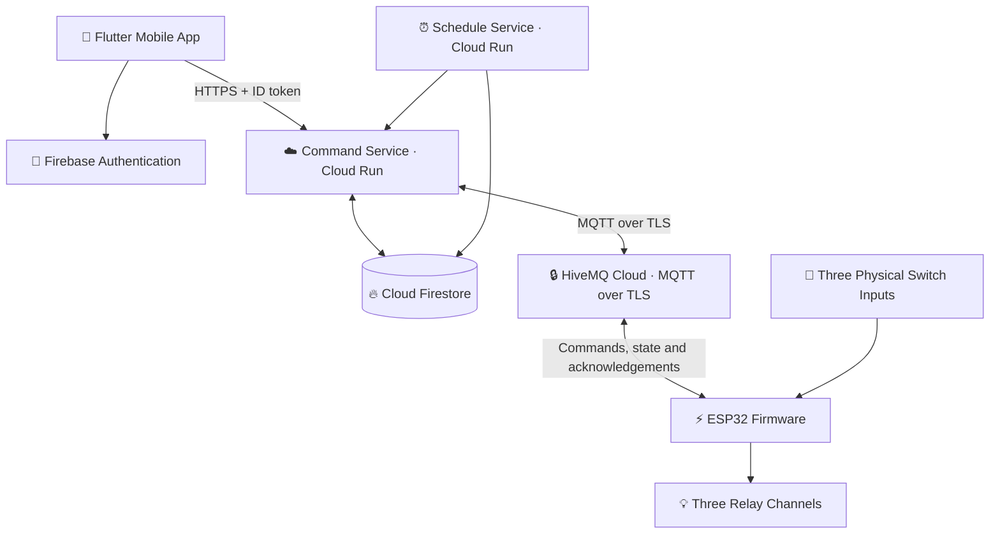

 <div align="center">

# 🏡 HAVEN

### Smart Living. Simplified.

**An ESP32-powered smart home automation platform for Android and iOS.**

Control appliances, manage rooms, automate schedules, and interact with your smart home through a modern Flutter application.

<br/>


</div>

---

## ✨ Overview

Haven is a smart home automation system designed to connect a mobile application with ESP32-based hardware over Wi-Fi. It combines appliance control, scheduling, voice interaction, real-time state updates, and cloud-connected device management in one platform.

The system is designed around three relay channels and three physical switch inputs, with a Flutter application for Android and iOS.

> **Project goal:** Make everyday appliance control more convenient, accessible, and intelligent without sacrificing hardware-level control.

## 🚀 Key Features

<table>
<tr>
<td width="50%" valign="top">

### 📱 Mobile Control
- Flutter application for Android and iOS
- Room and appliance management
- Appliance ON/OFF commands
- Device and home setup

</td>
<td width="50%" valign="top">

### ⚡ Smart Automation
- Time-based schedules
- Recurring automation
- Timezone-aware scheduling
- Schedule execution history

</td>
</tr>
<tr>
<td width="50%" valign="top">

### 🎙️ Voice Interaction
- Voice command processing
- Appliance-specific commands
- Permission-aware microphone access
- Integration with the normal command flow

</td>
<td width="50%" valign="top">

### ☁️ Cloud Connectivity
- Firebase Authentication
- Firestore real-time updates
- MQTT communication over TLS
- Push notifications and device status

</td>
</tr>
</table>

## 🖼️ Experience at a Glance

<div align="center">

| Home Dashboard | Appliance Control | Automation |
|:---:|:---:|:---:|
| Room overview | ON/OFF controls | Scheduled actions |
| Device status | Command feedback | Recurring routines |

</div>

*Replace these descriptions with real application screenshots or a short demo GIF as the UI and hardware integration become available.*

## 🏗️ System Architecture



### Communication Flow

1. The user issues a command from the mobile application.
2. The command service verifies the user's identity and authorization.
3. The backend publishes the command through the authenticated MQTT broker.
4. The ESP32 validates and executes the command.
5. The device reports its actual state and acknowledges the command.
6. The application displays the updated state.

The physical switches are intended to remain usable independently of cloud connectivity.

## 🧰 Technology Stack

| Layer | Technologies |
|---|---|
| Mobile application | Flutter, Dart |
| Authentication | Firebase Authentication |
| Database and live updates | Cloud Firestore |
| Backend services | Node.js, Express |
| Backend deployment | Google Cloud Run |
| Scheduling | Cloud Scheduler, schedule service |
| Messaging | HiveMQ Cloud, MQTT over TLS |
| Hardware | ESP32, relay channels, physical switch inputs |
| Firmware tooling | PlatformIO, Arduino framework |
| Notifications | Firebase Cloud Messaging |
| Security | Firebase Security Rules, App Check, authenticated device connections |

## 📁 Project Structure

```text
haven/
├── mobile/                     # Flutter mobile application
│   ├── android/                # Android platform
│   ├── ios/                    # iOS platform
│   ├── lib/
│   │   ├── core/                # Theme, routing and services
│   │   ├── features/
│   │   │   ├── auth/
│   │   │   ├── home_setup/
│   │   │   ├── dashboard/
│   │   │   ├── rooms/
│   │   │   ├── appliances/
│   │   │   ├── devices/
│   │   │   ├── schedules/
│   │   │   ├── voice/
│   │   │   ├── notifications/
│   │   │   ├── activity/
│   │   │   └── settings/
│   │   └── shared/
│   └── test/
├── backend/
│   ├── command-service/         # API and MQTT bridge
│   └── schedule-service/        # Schedule execution
├── firmware/                    # ESP32 firmware
│   └── src/
│       ├── main.cpp
│       ├── hardware_config.h
│       └── credentials_config.h # Local secrets; do not commit
├── firebase/
│   ├── firestore.rules
│   └── firestore.indexes.json
├── docs/                        # Documentation
├── scripts/                     # Utility scripts
└── README.md
```

## ⚙️ Getting Started

### Prerequisites

Install the tools required for the components you want to run.

- [Flutter SDK](https://docs.flutter.dev/get-started/install) — version 3.41.4 or compatible
- [Node.js](https://nodejs.org/) — version 22 or compatible
- [Firebase CLI](https://firebase.google.com/docs/cli)
- [Git](https://git-scm.com/)
- [PlatformIO](https://platformio.org/) — for ESP32 firmware
- [Google Cloud CLI](https://cloud.google.com/sdk/docs/install) — for backend deployment

### 1. Clone the Repository

```bash
git clone YOUR_REPOSITORY_URL
cd haven
```

Replace `YOUR_REPOSITORY_URL` with your actual repository URL.

### 2. Configure Firebase

1. Create a project in the [Firebase Console](https://console.firebase.google.com/).
2. Enable the required Authentication providers.
3. Create a Cloud Firestore database.
4. Register the Android application using package name `com.haven.smarthome`.
5. Register the iOS application using bundle identifier `com.haven.smarthome`.
6. Download the platform configuration files.
7. Configure App Check and push notifications where applicable.

Place the configuration files in their respective locations:

```text
mobile/android/app/google-services.json
mobile/ios/Runner/GoogleService-Info.plist
```

Deploy the database rules and indexes:

```bash
cd firebase
firebase login
firebase use --add
firebase deploy --only firestore:rules,firestore:indexes
```

### 3. Configure the MQTT Broker

Create a cluster using [HiveMQ Cloud](https://www.hivemq.com/mqtt-cloud-broker/).

Configure the broker hostname, TLS port, service credentials, and device-specific permissions. Store private credentials in environment configuration or a secrets manager—not in source control.

### 4. Configure and Run the Backend

Configure the command and schedule services using their respective environment templates.

```bash
cd backend/command-service
npm install
npm test
```

```bash
cd ../schedule-service
npm install
npm test
```

Deployment requires a configured Google Cloud project, appropriate service accounts and permissions, and valid Firebase and MQTT settings. Consult the service configuration and deployment requirements before deploying.

### 5. Run the Flutter Application

```bash
cd mobile
flutter pub get
flutter analyze
flutter test
flutter run
```

Configure the backend endpoint in:

```text
mobile/lib/core/constants/app_constants.dart
```

Ensure Firebase platform configuration and required permissions are set up before testing on a physical device.

### 6. Configure and Flash the ESP32

Before flashing firmware:

1. Verify every relay and switch pin against the actual PCB schematic.
2. Create the local device credentials configuration.
3. Configure Wi-Fi, device identity, and MQTT credentials.
4. Verify TLS configuration and broker permissions.

Build the firmware:

```bash
cd firmware
pio run
```

Flash a connected board:

```bash
pio run --target upload
pio device monitor
```

**Do not flash the firmware until the hardware pin assignments and relay polarity have been verified against your actual PCB.**

## 🔌 MQTT Topic Reference

| Topic | Direction | Purpose |
|---|---|---|
| `haven/{homeId}/{deviceId}/commands/control` | Backend → ESP32 | Appliance commands |
| `haven/{homeId}/{deviceId}/state/reported` | ESP32 → Backend | Reported device state |
| `haven/{homeId}/{deviceId}/state/availability` | ESP32 → Backend | Availability status |
| `haven/{homeId}/{deviceId}/ack/command` | ESP32 → Backend | Command acknowledgement |
| `haven/{homeId}/{deviceId}/telemetry` | ESP32 → Backend | Device telemetry |

## 🔐 Security Principles

- Verify Firebase ID tokens on protected backend requests.
- Keep privileged MQTT credentials on the backend.
- Use device-specific MQTT credentials and topic restrictions.
- Apply Firestore security rules to enforce home membership and access boundaries.
- Validate command expiry and command identifiers on the device.
- Protect secrets from Git and use a managed secret store for production.
- Test authentication, authorization, device pairing, and rejected commands before deployment.

## 🧪 Testing

Run the available tests for each component:

```bash
# Mobile
cd mobile
flutter analyze
flutter test
```

```bash
# Backend command service
cd backend/command-service
npm test
```

```bash
# Backend schedule service
cd ../schedule-service
npm test
```

Test real hardware separately for relay switching, physical switch behavior, connectivity loss, reconnects, command acknowledgement, and scheduling. Passing software tests alone does not prove correct physical operation.

## 🛡️ Production Readiness Checklist

- [ ] Firebase Authentication and database rules configured
- [ ] Firestore rules and indexes deployed and tested
- [ ] App Check configured for supported platforms
- [ ] MQTT broker configured with TLS and restricted credentials
- [ ] Backend services deployed and protected
- [ ] Schedule execution and timezone behavior verified
- [ ] Secrets excluded from source control
- [ ] Android release signing configured securely
- [ ] iOS signing and APNs configuration completed
- [ ] ESP32 pin mapping verified against the PCB schematic
- [ ] Physical switches tested during internet outages
- [ ] Relay behavior and command acknowledgements verified
- [ ] Real-device notifications and voice permissions tested
- [ ] Electrical safety independently verified

## ⚠️ Hardware Safety

> **Warning: Electrical hazard.** The relays may control mains-powered appliances. Incorrect wiring can cause fire, electric shock, serious injury, or death. Use properly rated and isolated components, appropriate fusing and enclosures, and have mains wiring verified by a qualified electrician. Software controls must not be treated as a substitute for electrical safety measures.

## 🗺️ Development Status

Haven is being developed as a complete mobile, cloud, and hardware automation system.

Actual completion depends on implementation and testing of each component. Physical ESP32 integration, deployment configuration, and production validation should be confirmed independently before describing the entire system as production-ready.

## 🤝 Contributing

For a private project, coordinate changes through your team's repository workflow. Before submitting changes, run the applicable tests and ensure credentials, local configuration, and generated build artifacts are not included.

## 📄 License

**Private project — All rights reserved.**

See the repository owner for permissions to use or distribute this project.

---

<div align="center">

### 🏡 HAVEN

*Connecting everyday living with thoughtful automation.*

**Built with Flutter · Firebase · ESP32**

</div>
