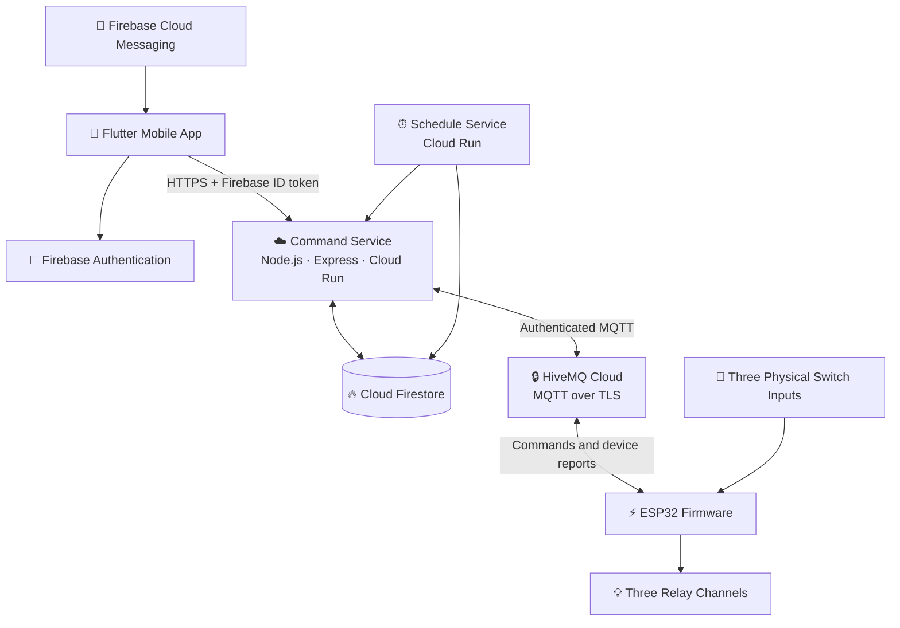

 <div align="center">

# 🏡 HAVEN

### Smart Living. Simplified.

**An ESP32-powered smart home automation platform for Android and iOS.**

Control appliances, manage rooms, automate schedules, and interact with your smart home through a modern Flutter application.

<br/>

[](https://flutter.dev/)
[](https://firebase.google.com/)
[](https://www.espressif.com/)
[](https://mqtt.org/)

<br/>


<br/>

*One home. Connected devices. Smarter everyday living.*

</div>

---

## 📖 About Haven

**Haven** is a smart home automation project designed to connect a mobile application with ESP32-based hardware over Wi-Fi.

The platform brings together appliance control, room management, scheduled automation, voice interaction, cloud connectivity, and real-time device status in one place.

The system is designed around an ESP32 controller with three relay channels and three physical switch inputs, managed through a Flutter application for Android and iOS.

### 🎯 Project Objectives

- Simplify everyday appliance control through a mobile application.
- Provide room-wise appliance management.
- Support time-based and recurring automation.
- Integrate voice-based appliance commands.
- Synchronize device state with a cloud-connected application.
- Keep physical switch operation available independently of cloud connectivity.

## ✨ Features

<table>
<tr>
<td width="50%" valign="top">

### 📱 Mobile Experience

- Android and iOS support
- Home dashboard
- Room and appliance management
- Appliance ON/OFF controls
- Device setup and management
- Application settings

</td>
<td width="50%" valign="top">

### ⚡ Automation

- Time-based schedules
- Recurring actions
- Timezone-aware scheduling
- Schedule management
- Command acknowledgements
- Execution history

</td>
</tr>
<tr>
<td width="50%" valign="top">

### 🎙️ Voice Interaction

- Voice command processing
- Appliance-specific actions
- Microphone permission handling
- Integration with the command service

</td>
<td width="50%" valign="top">

### ☁️ Cloud and IoT

- Firebase Authentication
- Cloud Firestore
- MQTT over TLS
- ESP32 device connectivity
- Device availability reporting
- Push notifications

</td>
</tr>
</table>

> Feature availability depends on implementation, configuration, and testing of the corresponding mobile, backend, and hardware components.

## 🏗️ System Architecture



### 🔄 Command Lifecycle

1. The user requests an appliance action in the mobile app.
2. The backend authenticates the request and checks authorization.
3. The command service publishes the command through MQTT over TLS.
4. The ESP32 validates the command and operates the appropriate relay.
5. The device reports its actual state and sends an acknowledgement.
6. The backend updates the relevant state, allowing the app to display the result.

The app should distinguish between a requested state and a confirmed hardware state. A pending command must not be presented as successful until the appropriate acknowledgement or state report is received.

## 🧰 Technology Stack

| Component | Technology |
|---|---|
| Mobile application | Flutter, Dart |
| Mobile platforms | Android, iOS |
| Authentication | Firebase Authentication |
| Realtime data | Cloud Firestore |
| Backend API | Node.js, Express |
| Backend hosting | Google Cloud Run |
| Device messaging | HiveMQ Cloud, MQTT over TLS |
| Hardware controller | ESP32 |
| Firmware tooling | PlatformIO, Arduino framework |
| Scheduling | Cloud Scheduler, schedule service |
| Push notifications | Firebase Cloud Messaging |
| Security | Firebase Security Rules, App Check, authenticated device connections |

## 📁 Repository Structure

```text
haven/
├── mobile/                       # Flutter mobile application
│   ├── android/                  # Android platform
│   ├── ios/                      # iOS platform
│   ├── lib/
│   │   ├── core/                 # Theme, routing, DI and services
│   │   ├── features/
│   │   │   ├── auth/             # Authentication
│   │   │   ├── home_setup/       # Home onboarding
│   │   │   ├── dashboard/        # Home dashboard
│   │   │   ├── rooms/            # Room management
│   │   │   ├── appliances/       # Appliance controls
│   │   │   ├── devices/          # Device management
│   │   │   ├── schedules/        # Automation schedules
│   │   │   ├── voice/            # Voice commands
│   │   │   ├── notifications/    # Notifications
│   │   │   ├── activity/         # Activity history
│   │   │   └── settings/         # App settings
│   │   └── shared/               # Shared models and widgets
│   ├── test/                     # Flutter tests
│   └── pubspec.yaml
│
├── backend/
│   ├── command-service/          # API and MQTT bridge
│   └── schedule-service/         # Schedule execution
│
├── firmware/                     # ESP32 firmware
│   ├── src/
│   │   ├── main.cpp
│   │   ├── hardware_config.h
│   │   └── credentials_config.h  # Local credentials; never commit
│   └── platformio.ini
│
├── firebase/
│   ├── firestore.rules
│   └── firestore.indexes.json
│
├── docs/                         # Project documentation
├── scripts/                      # Utility scripts
└── README.md
```

## ⚙️ Getting Started

### Prerequisites

Install the following tools before setting up the relevant components.

| Tool | Version | Documentation |
|---|---|---|
| Flutter | 3.41.4 or compatible | [Install Flutter](https://docs.flutter.dev/get-started/install) |
| Node.js | 22 or compatible | [Node.js](https://nodejs.org/) |
| Firebase CLI | Compatible current release | [Firebase CLI](https://firebase.google.com/docs/cli) |
| Git | Current release | [Git](https://git-scm.com/) |
| PlatformIO | Current release | [PlatformIO](https://platformio.org/) |
| Google Cloud CLI | Current release | [Google Cloud CLI](https://cloud.google.com/sdk/docs/install) |

### 1. Clone the Repository

```bash
git clone YOUR_REPOSITORY_URL
cd haven
```

Replace `YOUR_REPOSITORY_URL` with the HTTPS or SSH URL of your repository.

### 2. Set Up Firebase

1. Open the [Firebase Console](https://console.firebase.google.com/).
2. Create a Firebase project.
3. Enable the required authentication providers.
4. Create a Cloud Firestore database.
5. Register the Android application with package name `com.haven.smarthome`.
6. Register the iOS application with bundle identifier `com.haven.smarthome`.
7. Download the platform-specific configuration files.

Place the configuration files at:

```text
mobile/android/app/google-services.json
mobile/ios/Runner/GoogleService-Info.plist
```

Configure App Check and Firebase Cloud Messaging as needed for the target platforms.

### 3. Deploy Firestore Rules and Indexes

Make sure the Firebase CLI is installed and you have access to the correct Firebase project.

```bash
cd firebase
firebase login
firebase use --add
firebase deploy --only firestore:rules,firestore:indexes
```

Review and test the security rules before deploying to a production project.

### 4. Configure the MQTT Broker

Create a cluster using [HiveMQ Cloud](https://www.hivemq.com/mqtt-cloud-broker/).

Configure:

- Broker hostname and TLS port.
- Service-level MQTT credentials.
- Device-specific credentials.
- Topic-level permissions.
- TLS certificate verification.

Keep broker passwords and other private credentials outside source control.

### 5. Configure the Backend

Configure the command service and schedule service using their environment templates.

Install dependencies and run available tests:

```bash
cd backend/command-service
npm install
npm test
```

```bash
cd ../schedule-service
npm install
npm test
```

Before deploying, configure the Firebase project, MQTT connection, service accounts, secrets, and required environment variables.

#### Deploy the Command Service

From `backend/command-service`, configure the required environment and secret references, then deploy using Google Cloud Run:

```bash
gcloud run deploy haven-command-service \
  --source . \
  --region us-central1 \
  --platform managed
```

Configure authentication and ingress explicitly according to the service's security design. Do not expose a privileged command endpoint without authentication and authorization.

#### Deploy the Schedule Service

From `backend/schedule-service`, configure the service and deploy:

```bash
gcloud run deploy haven-schedule-service \
  --source . \
  --region us-central1 \
  --platform managed
```

Configure Cloud Scheduler to invoke the schedule endpoint using authenticated service-to-service requests. The exact scheduler configuration depends on the deployed URL and service account.

### 6. Run the Flutter App

```bash
cd mobile
flutter pub get
flutter analyze
flutter test
flutter run
```

Configure the command-service URL in:

```text
mobile/lib/core/constants/app_constants.dart
```

Ensure the Firebase platform configuration files are present and the backend endpoint is correct for your development environment.

### 7. Build Android

For a release build, configure Android signing credentials securely and keep keystores and passwords out of Git.

```bash
cd mobile
flutter build apk --release
```

To generate an Android App Bundle for Play Store distribution:

```bash
flutter build appbundle --release
```

Typical output paths:

```text
build/app/outputs/flutter-apk/app-release.apk
build/app/outputs/bundle/release/app-release.aab
```

### 8. Build iOS

An iOS release build requires macOS and Xcode.

```bash
cd mobile
flutter pub get
cd ios
pod install
cd ..
flutter build ios --release
```

Open the Xcode workspace to configure signing and archive the app:

```bash
open ios/Runner.xcworkspace
```

iOS distribution also requires the appropriate provisioning profiles and Apple developer configuration.

## 🔌 ESP32 Firmware Setup

### Prerequisites

- ESP32 development board compatible with your PCB.
- PlatformIO IDE or CLI.
- USB cable for flashing.
- Actual PCB schematic for pin verification.
- Wi-Fi network and configured MQTT broker.

### ⚠️ Verify Hardware Configuration

Before flashing, inspect:

```text
firmware/src/hardware_config.h
```

Confirm every relay and switch pin against the actual PCB schematic. Example pin definitions must not be assumed to match the physical board.

```cpp
// Example values only. Verify every pin against your PCB.

#define RELAY_CH0_PIN  26
#define RELAY_CH1_PIN  27
#define RELAY_CH2_PIN  14

#define SWITCH_CH0_PIN 34
#define SWITCH_CH1_PIN 35
#define SWITCH_CH2_PIN 32

#define RELAY_ACTIVE_HIGH false
```

Verify relay polarity, GPIO suitability, electrical isolation, and the required pull-up or pull-down behavior before powering the circuit.

### Configure Device Credentials

Create the local configuration file:

```text
firmware/src/credentials_config.h
```

Populate the required values for your environment:

```cpp
#define WIFI_SSID        "your_wifi_ssid"
#define WIFI_PASSWORD    "your_wifi_password"

#define DEVICE_ID        "your-device-id"
#define HOME_ID          "your-home-id"

#define MQTT_USERNAME    "your-device-username"
#define MQTT_PASSWORD    "your-device-password"
#define MQTT_BROKER_HOST "your-broker-hostname"
```

These values are examples, not real credentials. Follow the firmware's actual configuration interface and pairing implementation.

**Never commit real Wi-Fi passwords, MQTT credentials, or other private keys.**

### Build and Flash

From the firmware directory:

```bash
cd firmware
pio run
```

Flash the connected board:

```bash
pio run --target upload
```

Monitor serial output:

```bash
pio device monitor
```

Verify Wi-Fi connectivity, authenticated MQTT connection, device registration, relay behavior, switch inputs, and state reporting on the actual hardware.

## 🔗 MQTT Topic Reference

| Topic | Direction | Purpose |
|---|---|---|
| `haven/{homeId}/{deviceId}/commands/control` | Backend → ESP32 | Control commands |
| `haven/{homeId}/{deviceId}/state/reported` | ESP32 → Backend | Reported appliance state |
| `haven/{homeId}/{deviceId}/state/availability` | ESP32 → Backend | Device availability |
| `haven/{homeId}/{deviceId}/ack/command` | ESP32 → Backend | Command acknowledgement |
| `haven/{homeId}/{deviceId}/telemetry` | ESP32 → Backend | Device telemetry |

The backend and firmware must agree on topic names, payload formats, QoS, command identifiers, expiry behavior, and authorization rules.

## 🔐 Security

Haven's intended security model includes the following controls:

1. **Authenticated API requests:** Verify Firebase ID tokens on protected endpoints.
2. **Backend-controlled commands:** Keep privileged MQTT credentials out of the mobile application.
3. **Device-level access:** Restrict each device to its authorized MQTT topics.
4. **Database access control:** Enforce user and home membership using Firestore security rules.
5. **Command validation:** Validate command structure, authorization, identifiers, and expiry before execution.
6. **App integrity:** Configure Firebase App Check where supported.
7. **Secret management:** Store private credentials in an appropriate secret manager or secure local configuration.

Security configuration must be tested before production deployment. A badge or configuration file alone does not establish that a system is secure.

## 🧪 Testing

### Flutter

```bash
cd mobile
flutter analyze
flutter test
```

### Command Service

```bash
cd backend/command-service
npm test
```

### Schedule Service

```bash
cd backend/schedule-service
npm test
```

### Firestore Emulator

Install and configure the Firebase CLI, then run:

```bash
cd firebase
firebase emulators:start --only firestore
```

Run the project's actual security-rule tests against the emulator where available.

### Hardware Validation

Test the complete system with the physical PCB:

- Relay switching and polarity.
- Physical switch behavior without internet access.
- MQTT disconnections and reconnects.
- Command acknowledgements and expiry.
- Schedule execution across midnight and timezone changes.
- Actual device state synchronization.
- Voice permissions and push notifications on supported devices.

## 🔗 Device Pairing

The intended pairing workflow is:

1. Open the Haven application and navigate to device setup.
2. Initiate the pairing process.
3. Register the device using the pairing mechanism implemented by the backend.
4. Provision the device with the appropriate network and device credentials.
5. Confirm that the ESP32 connects to the broker.
6. Verify that the device appears in the application.
7. Test all three channels and their physical switch inputs.

Use the pairing procedure implemented in the current codebase; do not expose permanent device credentials in the user interface or repository.

## 🛡️ Production Readiness Checklist

### Cloud and Security

- [ ] Firebase project configured.
- [ ] Authentication providers enabled and tested.
- [ ] Firestore rules and indexes deployed.
- [ ] App Check configured for supported platforms.
- [ ] MQTT TLS and device permissions verified.
- [ ] Backend endpoints authenticated and authorized.
- [ ] Secrets stored outside source control.
- [ ] Schedule execution protected against unauthorized requests.

### Mobile

- [ ] Android Firebase configuration added.
- [ ] iOS Firebase configuration added.
- [ ] Backend endpoint configured.
- [ ] Android release signing configured.
- [ ] iOS signing and provisioning configured.
- [ ] Voice permissions tested.
- [ ] Push notifications tested on real devices.

### Hardware

- [ ] ESP32 pin mapping checked against the PCB schematic.
- [ ] Relay polarity verified.
- [ ] Device credentials provisioned securely.
- [ ] Physical switches tested without cloud connectivity.
- [ ] Command acknowledgements verified.
- [ ] Reconnection and failure behavior tested.
- [ ] Mains-connected wiring checked by a qualified electrician.

## ⚠️ Known Limitations

- **iOS builds:** Require macOS and Xcode.
- **Hardware pin mapping:** Example pin values must be verified against the actual PCB.
- **Physical testing:** Software compilation alone does not verify relay and switch behavior.
- **Cloud configuration:** Firebase, MQTT, and Google Cloud resources must be configured for the target environment.
- **Push notifications:** iOS notifications require appropriate APNs and Firebase configuration.
- **Broker capacity:** Check your selected HiveMQ plan for connection and usage limits.

## 🆘 Troubleshooting

<details>
<summary><strong>ESP32 cannot connect to MQTT</strong></summary>

- Verify the broker hostname and TLS port.
- Check device credentials and topic permissions.
- Confirm that the Wi-Fi network is available.
- Verify TLS certificate validation.
- Inspect serial output and broker logs.

</details>

<details>
<summary><strong>The app does not receive real-time updates</strong></summary>

- Confirm that the device is connected.
- Check Firestore permissions and listeners.
- Verify that the backend processes device reports.
- Inspect application and backend logs.

</details>

<details>
<summary><strong>Commands do not reach the appliance</strong></summary>

- Check command-service logs.
- Verify the MQTT connection and topic subscription.
- Confirm that the command has not expired.
- Check device acknowledgements and reported state.
- Verify relay wiring and pin assignments.

</details>

<details>
<summary><strong>Voice commands do not work</strong></summary>

- Grant microphone and speech-recognition permissions.
- Check device language support.
- Confirm that the spoken appliance name matches the configured name.
- Verify that recognized commands use the same authorized command pipeline as manual controls.

</details>

<details>
<summary><strong>Flutter dependencies or builds fail</strong></summary>

From the mobile directory, run:

```bash
flutter doctor
flutter pub get
flutter analyze
```

Check the installed Flutter version, platform SDKs, dependency constraints, and build logs.

</details>

## ⚡ Electrical Safety

> **WARNING — MAINS VOLTAGE HAZARD**
>
> Relays may control appliances connected to mains electricity. Incorrect wiring can cause electric shock, fire, serious injury, or death.
>
> Use properly rated components, suitable isolation, fusing, and enclosures. Have mains wiring reviewed by a qualified electrician. Never rely solely on a mobile application or cloud service as a safety mechanism.

## 📄 License

**Private project — All rights reserved.**

Unauthorized copying, redistribution, or commercial use is not permitted without authorization from the project owner.

---

<div align="center">

### 🏡 HAVEN

**Smart Living. Simplified.**

*Designed to connect homes, devices, and everyday routines.*

<br/>

[Flutter](https://flutter.dev/) · [Firebase](https://firebase.google.com/) · [ESP32](https://www.espressif.com/) · [MQTT](https://mqtt.org/)

</div>
